# ⚡ GRID — build a power grid, keep the lights on

**[Site](https://grid.blackmetal.tech)** · **[Wiki](https://grid.blackmetal.tech/wiki/)** · **[Releases](https://github.com/blackmetaltech/grid/releases)** · **[Changelog](CHANGELOG.md)** · **[Critique](docs/CRITIQUE-1.16.md)** · **[Issues](https://github.com/blackmetaltech/grid/issues)**

**Build a power grid one job at a time. Then run the day and watch it hold, or fail.** Demand climbs at dusk. A storm opens a line. Towns go dark street by street, because the windows are lit by your own power flow.

The game runs in **Godot 4.7**. Every rule runs in a **deterministic TypeScript engine**: an AC load flow, the swing equation, harmonics, relay curves. The same inputs always give the same day.

> **Alpha, 1.16.** The whole campaign, eight chapters and a finale, is playable and has been played to a win at every chapter. **The finale and chapter 3 are drawn in the new 3D look.** The other chapters and the Career keep the classic 2D look for now; their job cards say "Classic".

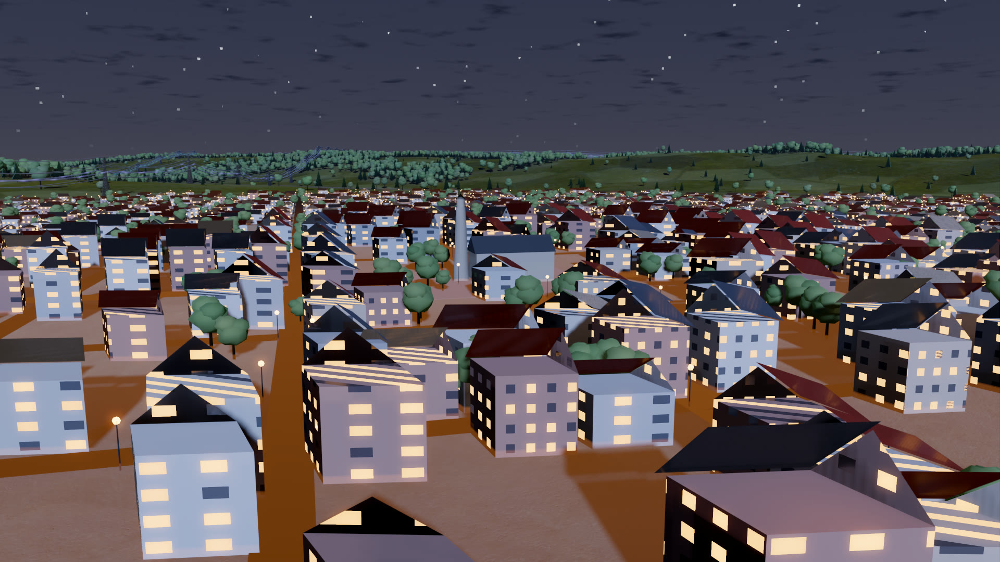

### What's new in 1.16: the finale makes you choose, and chapter 3 is in 3D

| The capital at dusk, with the two calls you can make during the run | Chapter 3: the mill town at 18:30, power factor 0.95 after the bank |
|---|---|
| 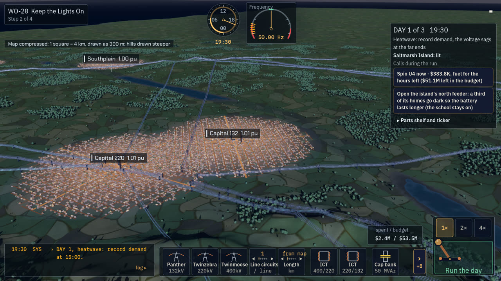 | 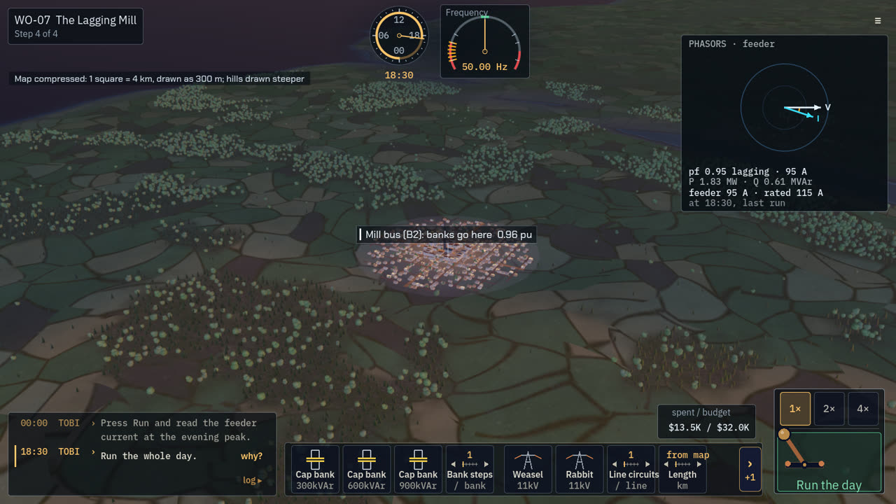 |
| **The report gives you the sum, not the answer** | **Lightning takes the island's only feeder, and the island goes dark** |
| 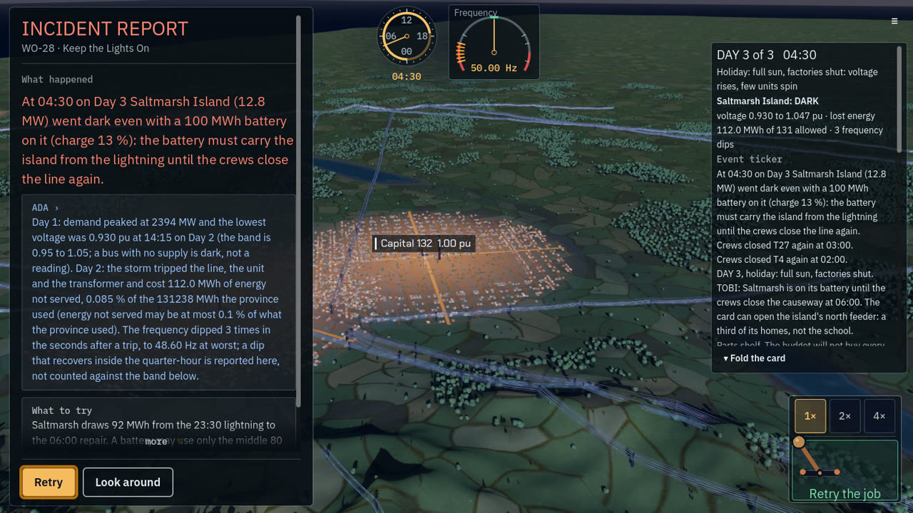 | 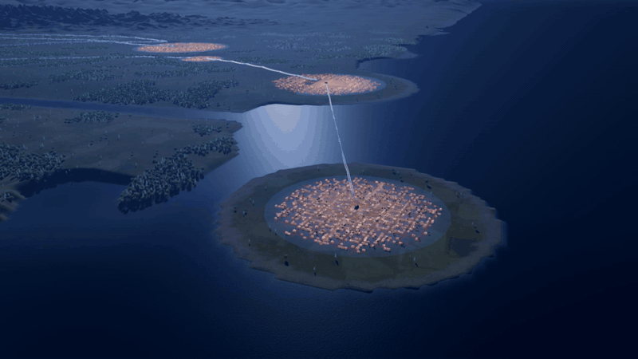 |

- The finale's budget is $53.5M. The safest set no longer fits.
- During the run the radio asks you to spin a gas unit, and at the lightning you can open the island's north feeder.
- The report gives the island's draw and the battery's window. You do the sum.
- Towns have spires and works chimneys. Day has fields of pasture, crop and plough.
- Wind and crickets in the 3D look. No human has listened to them yet.

Older releases: see the [CHANGELOG](CHANGELOG.md).

## What you actually do

| | |
|---|---|
| **Read the job** | A goal, the numbers to pass, three lamps to earn. |
| **Build** | Pick parts from the tray. Every part has a price. |
| **Operate** | Click what you built: breakers, tap changers, capacitor steps, unit commitment. |
| **Run the day** | Pull the lever. Voltages, loadings and frequency move as the clock runs. |
| **Read the report** | What happened, in your own numbers. A lost day names the first thing that failed. |
| **Prove it** | Exam levels ask for the number before the game shows it. |

**The campaign.** A prologue, 36 levels, eight chapters and a finale. It runs from Ohm's law on a beach to a 400 kV province.

**Career: The Utility.** Ten years as a district engineer, one quarter at a time. Nine districts, plus one weekly district that is the same for everyone.

**Modes.** Learner explains as it goes. Engineer uses per-unit values and stricter limits. Cute adds faces; the drawings still follow the physics.

**Honest by design.** Textbook equations, not tuned curves. A full AC load flow every 15 minutes.

## See it in action


*Recorded in the game.*

## Classic look (chapters 1, 2, 4 to 8 and the Career)

These chapters still use the 2D look.


| The work order | The river line (chapter 2) |
|---|---|
|  |  |
| **The bench: one cable to a hamlet (chapter 1)** | **A plain capacitor bank: resonance at h = 8.6, near the 7th (chapter 3)** |
|  |  |

| Generator phasors (chapter 4) | The nose of the curve (chapter 5) |
|---|---|
| 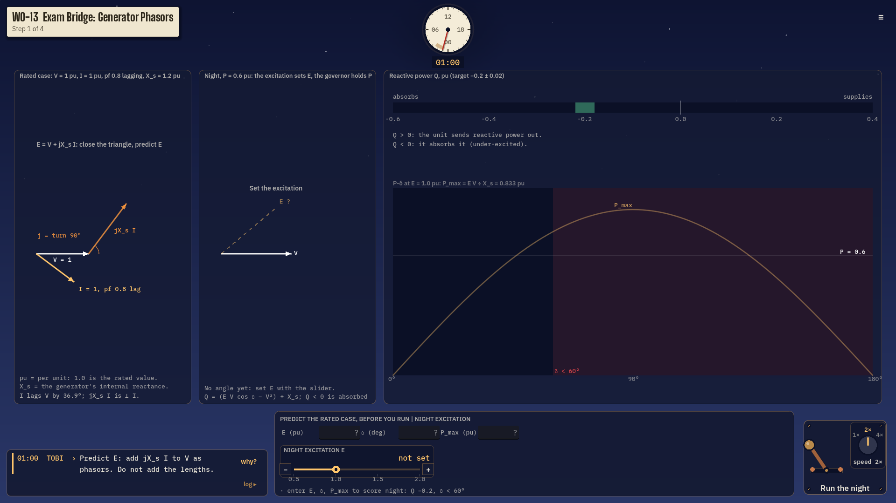 | 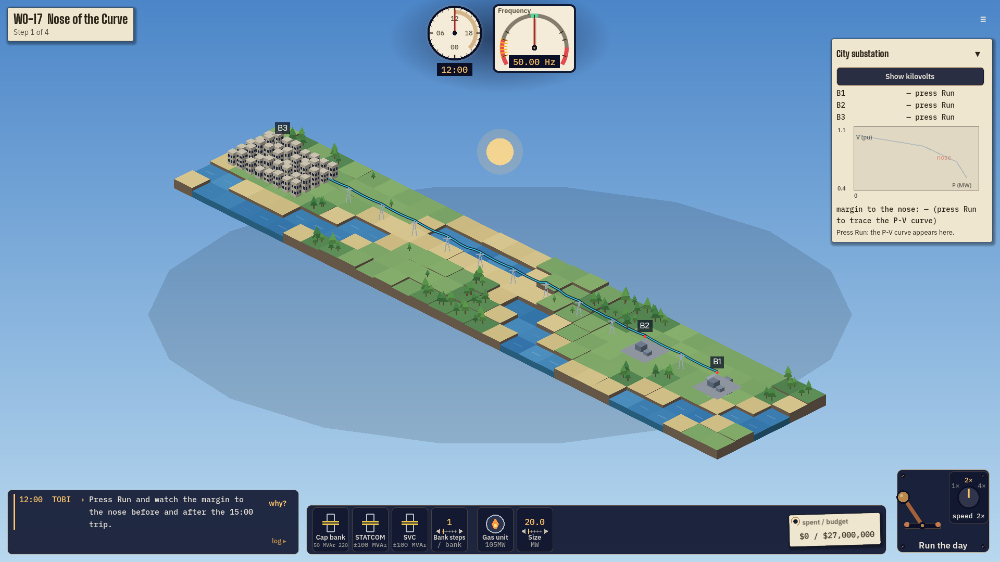 |
| **The sun goes down: four peakers and the pumps at noon (chapter 6)** | **Relay coordination (chapter 7)** |
|  | 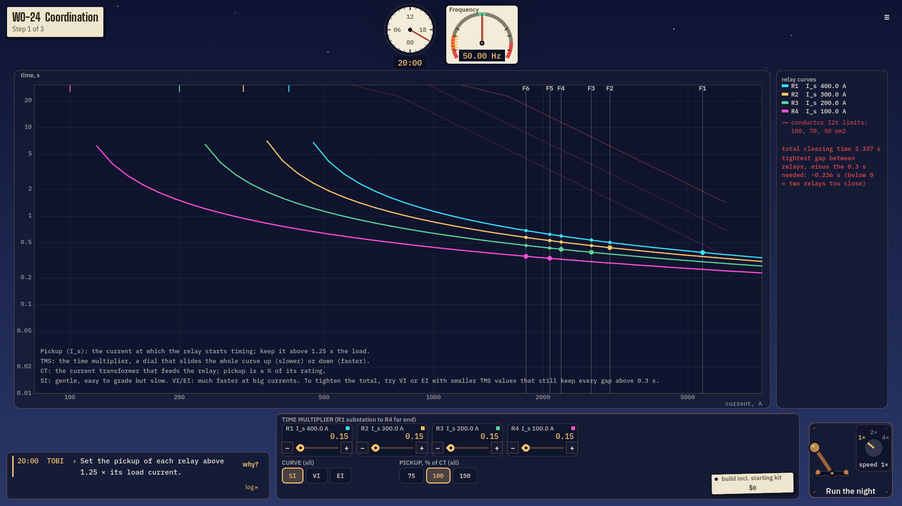 |
| **Recloser and fuses on a time-current chart (chapter 8)** | **Career: the district at year 1** |
| 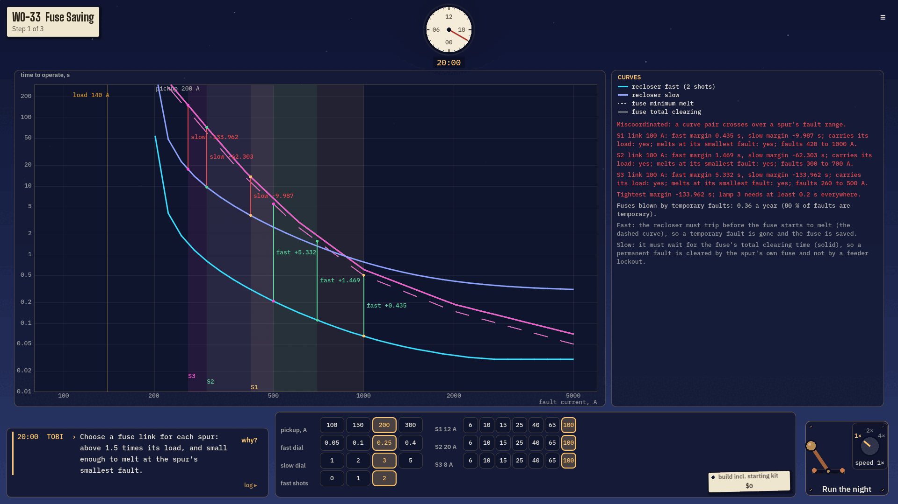 | 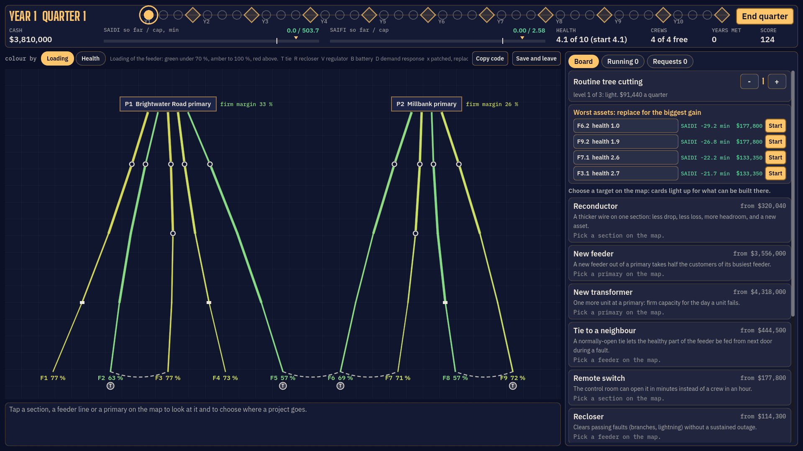 |
| **The finale won, three lamps** | |
| 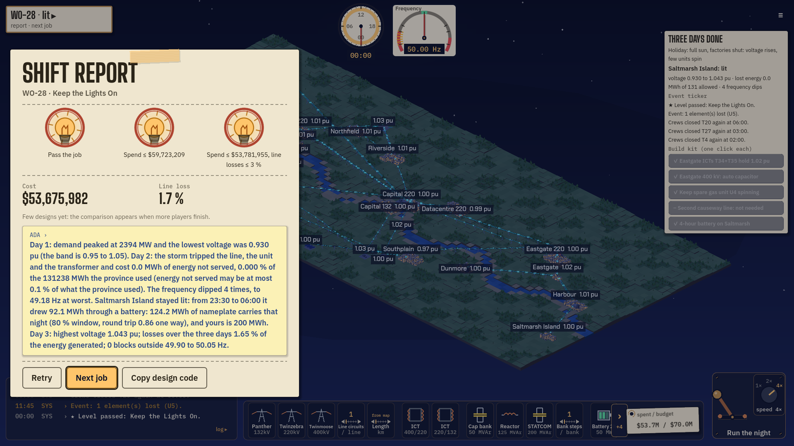 | |

## Download

From [Releases](https://github.com/blackmetaltech/grid/releases). Each release is built and smoke-tested on Linux before upload, with a `SHA256SUMS.txt`. Node.js is bundled; nothing else to install.

| OS | File | Run |
|---|---|---|
| Linux (x86_64) | `GRID-<ver>-linux-x86_64.zip` | unzip, then `GRID/grid.sh` (needs a Vulkan-capable GPU/driver) |
| Windows (x64) | `GRID-<ver>-windows-x64.zip` | unzip, then `GRID\GRID.exe` (unsigned: SmartScreen, *More info → Run anyway*). Not yet played on Windows. |

No macOS build is attached yet. An Android debug APK can be built locally with `core/qa/buildapk.sh`.

## Run from source

Needs **Node.js 18+**, **pnpm** and **Godot 4.7**.

```sh
git clone --recursive <this repo>        # core/ is the cobanana-core submodule (not public yet)
pnpm install
pnpm bridge                              # builds the engine sidecar → godot/sidecar/bridge.mjs
godot --headless --path godot --import   # once, and after adding class_name scripts
godot --path godot                       # play
```

| Task | Command |
|---|---|
| typecheck | `pnpm typecheck` |
| engine, level, oracle and golden tests | `./node_modules/.bin/vitest run` |
| regenerate goldens (deliberate rule change only) | `GOLDEN_UPDATE=1 pnpm test` |
| Godot flow and truth tests, then the UI smoke | `node scripts/test-godot.mjs` |
| no literal strings in GDScript | `node scripts/lint-strings.mjs` |
| regenerate the player wiki (site/wiki) | `pnpm wiki` |
| desktop play-test harness (Xvfb) | `core/qa/desk.sh` (see `core/qa/README.md`) |

## Architecture

```
src/                     the TypeScript engine (deterministic, no I/O)
  sim/loadflow/          Newton-Raphson, Gauss-Seidel, DC flow, continuation (the nose curve), sensitivities
  sim/bench/             modified nodal analysis for the DC and single-phase bench, harmonics, four-wire, the machine
  sim/dynamics/          the frequency window (swing equation, governors, batteries, UFLS) and the SMIB swing
  sim/protection/        relays, breakers, fault levels      sim/thermal/  overload and cascades
  sim/route/             terrain, line routes, sag and clearance, insulation     sim/ch4, ch7, ch8  chapter models
  sim/distrib/           radial sweep load flow, IEEE 1366 reliability, recloser/fuse curves, IEC 60076-7 hot-spot, PV hosting
  career/                Career mode: district, ageing, growth, events, money, regulator, replay (career-game.ts wires it in)
  level/levels/          P0 and L01-L36: allowed parts, pass conditions, naive / lesson / reference builds, coach steps
  regions/               region packs (global, in): catalogues, prices, grid codes, pinned data hashes
  oracles/               typed loader for the oracle values (tools/oracles/*.py computes them independently)
godot/                   Godot 4.7 front end (GDScript)
  world/world_view.gd    the isometric diorama: terrain, towns lit by the power flow, lines, devices, pegs
  ui/                    trays, work order, shift report, radio, dials, chapter panels (ch2-ch8, chf = the finale), career/ (Career screens)
  tests/                 flow and truth tests run by scripts/test-godot.mjs
  sidecar/bridge.mjs     the built engine (pnpm bridge)
core/                    cobanana-core (submodule): engine kit, Godot app shell, QA harness, CI and packaging
```

## Status

1.14. **1528 engine tests in 71 files** and **26 Godot steps** (25 flow and truth tests plus the UI smoke, paper flow and Career flow) pass on every tag. Wall-clock perf budgets are re-run alone when the machine is loaded. Every clock time and quantity a level's text quotes is checked against the engine by a test.

- Played on desktop Linux only. The gamepad pass used scripted pad events in the game window at 1280×800, not a physical pad; no one has played it on a phone; the phone layout was checked on a desktop window at 2424×1080. On the phone layout chapter 8's study screens pan (drag or wheel) to clear the coach card.
- The Windows build is produced but not played on Windows; there is no macOS build on the releases.
- Sound: four synthesised tracks and a cue per interaction, measured (loudness, clipping, structure) but not yet listened to by a person.
- Building from source needs the cobanana-core submodule, which is not public yet.
- The weekly board needs a cobanana-scores host. None is public yet, so it has only been tested against a local development server.
- Not yet in the game: substation bus schemes, earth faults, multi-machine stability, a week of unit commitment.

See [docs/CRITIQUE-1.16.md](docs/CRITIQUE-1.16.md) for the harsh version.
