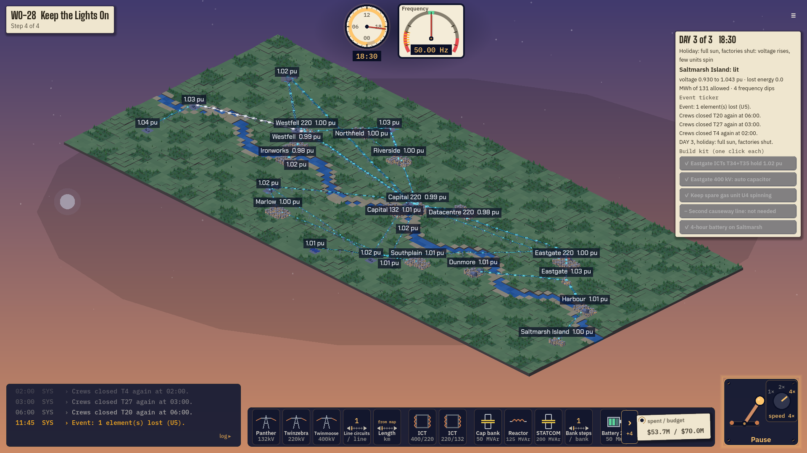
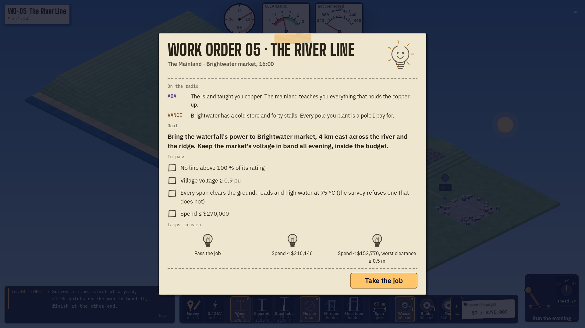
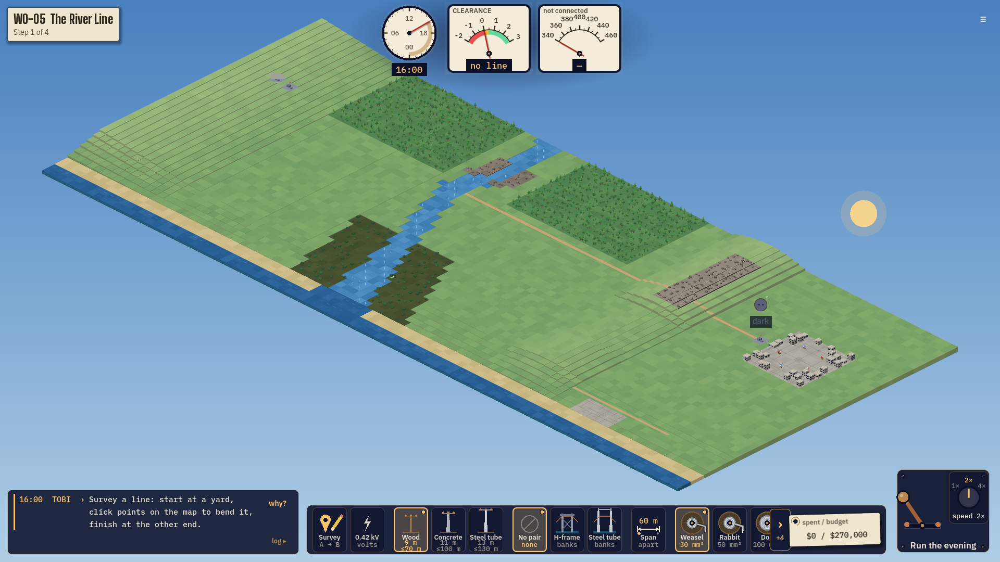
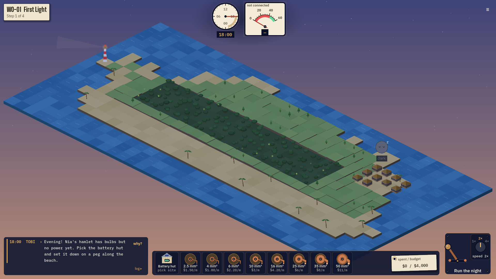
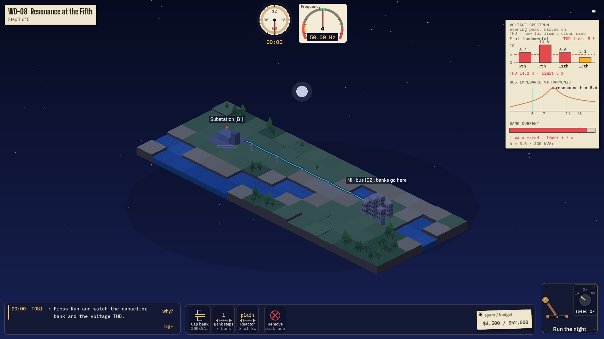
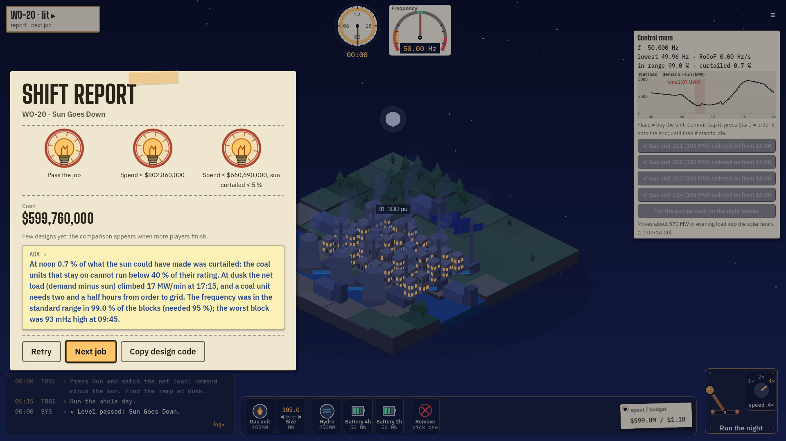

# ⚡ GRID — keep the lights on with real physics

**[Releases](https://github.com/ixaxaar/grid/releases)** · **[Changelog](CHANGELOG.md)** · **[Critique](docs/CRITIQUE-1.1.md)** · **[Issues](https://github.com/ixaxaar/grid/issues)**

**Build a province's power grid, one job at a time, and watch it run the day.** You start by sizing one cable from a battery hut to a ten-home hamlet. Then you string a 11 kV line across a river, tame a mill's harmonics, balance three phases, hold a 400 kV ring's voltage, ride a dusk ramp with peakers and pumped hydro, set relay curves and dispatch a merit order. Then you press **Run**: demand climbs at dusk, the sun sets on the solar parks, a storm opens a line, a big unit trips. Voltages sag, the frequency dips, breakers open and towns go dark window by window. The windows are lit by your power flow, so every mistake shows up on the map.

The front end is a **Godot 4.7** game: an isometric diorama of the island and the province, paper work orders and shift reports, analogue dials and a radio log. Every rule runs in a **deterministic TypeScript engine** that Godot drives through a headless Node sidecar: a Newton-Raphson AC load flow, a modified-nodal bench solver, the swing equation with governors, harmonics, IEC relay curves and line thermal limits. A design code reproduces a build exactly, because the same inputs always give the same day.

> **1.1 "Employable" (private).** The whole campaign, now eight chapters, is playable and has been played to a win at every chapter. A ten-year Career mode runs a distribution district. It runs on desktop Linux, with mouse, controller or touch, in a desktop or a phone layout. Builds for Windows and macOS come from the release workflow but have not been played on those systems. Rough edges and known gaps are listed in the [changelog](CHANGELOG.md) and the [critique](docs/CRITIQUE-1.1.md).



## What you actually do

| | |
|---|---|
| **Read the job** | Each level opens with a work order: the place, three characters on the radio, the goal in plain words, the pass conditions with their numbers, and the three lamps you can earn. |
| **Build** | A tray at the bottom holds the level's parts: cables by cross-section, pole families and conductors for a surveyed line route, transformers, capacitor banks and reactors, STATCOMs, gas units, pumped hydro and batteries. Each part shows its price, and the budget tag keeps the running total. |
| **Operate** | Click anything you built for its tag: breakers, tap changers, capacitor steps and automatic bands, governor droop, unit commitment, store charging clocks. |
| **Run the day** | A lever runs the 24-hour clock at 1×, 2× or 4×. Bus voltages, line loadings and the frequency move on the dials and on the map while it runs. |
| **Read the report** | A shift report or an incident report. A lost day names the first thing that failed, with the numbers from your own run, and what to try next. A won day lights one to three lamps for passing, cost and a stretch goal. **Retry** keeps your build. |
| **Prove it** | The exam-bridge levels hand you the givens and ask for the number before the game shows it: a Gauss-Seidel iteration, a fault level, droop and RoCoF, a merit-order λ. |

**The campaign.** A prologue and **36 levels** in eight chapters and a finale. Chapter 1 is a DC bench (Ohm's law, cable resistance, the price of distance). Chapter 2 is the mainland line: route survey, sag and clearance, pole spans over a river, transformers at each end, salt on the insulators, and bringing the island home on a sea cable. Chapter 3 covers phasors, power factor and harmonics. Chapter 4 covers three-phase systems and machines (unbalance, star and delta, the P-δ curve). Chapter 5 is load flow and voltage (per unit, the long line, loop flow, the nose curve). Chapter 6 is frequency and renewables (fifty hertz, the duck curve, inertia). Chapter 7 is protection and markets (fault level, relay coordination, clearing time, merit order). Chapter 8 is distribution, the work of a junior engineer at a distribution company: voltage drop down a 16 km feeder, SAIFI and SAIDI with fuses, sectionalisers and a tie, recloser-fuse coordination on a time-current chart, N-1 at a primary substation with transformer hot-spot ageing, and rooftop solar hosting with tap-changer line-drop compensation and volt-var. The finale, **Keep the Lights On**, runs the whole province for three days: a heatwave, a storm that trips a line, a unit and a transformer, and a holiday with full sun and no factories.

**Career: The Utility.** Ten years, one quarter at a time, as the district engineer for about 40,000 customers on two primary substations and nine feeders. You pick projects from a board: reconductoring, new feeders and transformers, ties, remote switches, reclosers, tree clearance, replacing worn assets, batteries and demand response. Each card shows what it does to expected SAIDI, loading and firm margin. Assets age along Weibull curves, load grows, storms and failures are drawn from the quarter's odds, and connection requests arrive with deadlines. Each year the regulator, the finance director and the crew chief review you, and a simplified performance incentive pays or fines on SAIDI and SAIFI against target. It ends as Chief Engineer, Steady, Bailed out or Licence revoked. A career is a seed plus your actions, so its code is also the save.

**Modes.** **Learner** explains as it goes. **Engineer** uses per-unit values and stricter limits. A **Cute** toggle in the pause menu adds faces and doodles; the drawings still follow the physics. Two region packs ship with the engine: `global` (US$, IEC voltages, the default) and `in` (₹, the Indian grid code). Both are run by the test suite.

**Honest by design.** The rules are textbook equations, not tuned curves. The grid levels solve a full AC load flow every 15-minute block. A trip runs a 10 ms RK4 frequency window with governors, batteries and under-frequency load shedding. Relays use IEC inverse-time curves, and conductors carry their real names and resistances. The engine is checked against **71 core oracle cases** and a set per chapter, all computed independently in Python (`tools/oracles/`). Each level has a "naive" build that must fail and a reference build that must pass, both in the test suite. Some things are simplified. Time runs in 15-minute blocks, with second-scale dynamics only in the window after an event. Transients are not electromagnetic. Places and companies are fictional. Prices are typical figures, not quotes.

## Screenshots

| The work order | The river line (chapter 2) |
|---|---|
|  |  |
| **The bench: one cable to a hamlet (chapter 1)** | **A plain capacitor bank: resonance at h = 8.6, near the 7th (chapter 3)** |
|  |  |

## The chapters

| Generator phasors (chapter 4) | The nose of the curve (chapter 5) |
|---|---|
|  |  |
| **The sun goes down: four peakers and the pumps at noon (chapter 6)** | **Relay coordination (chapter 7)** |
|  |  |
| **Recloser and fuses on a time-current chart (chapter 8)** | **Career: the district at year 1** |
|  |  |
| **The finale won, three lamps** | |
|  | |

## Download

Releases are private for now. Each `v*` tag builds archives through `.github/workflows/release.yml`. Node.js is bundled; nothing else to install.

| OS | File | Run |
|---|---|---|
| Linux (x86_64) | `GRID-<ver>-linux.tar.xz` | `tar xf`, then `GRID/grid.sh` (needs a Vulkan-capable GPU/driver) |
| Windows (x64) | `GRID-<ver>-windows.zip` | `GRID\GRID.exe` (SmartScreen: *More info → Run anyway*) |
| macOS, Apple Silicon | `GRID-<ver>-macos-arm64.tar.xz` | `xattr -dr com.apple.quarantine GRID.app`, then open |
| macOS, Intel | `GRID-<ver>-macos-x64.tar.xz` | same as above |

Builds are unsigned, hence the OS warnings. An Android debug APK can be built locally with `core/qa/buildapk.sh`.

## Run from source

Needs **Node.js 18+**, **pnpm** and **Godot 4.7**.

```sh
git clone --recursive <this repo>        # or: git submodule update --init
pnpm install
pnpm bridge                              # builds the engine sidecar → godot/sidecar/bridge.mjs
godot --headless --path godot --import   # once, and after adding class_name scripts
godot --path godot                       # play
```

| Task | Command |
|---|---|
| typecheck | `pnpm typecheck` |
| engine, level, oracle and golden tests | `./node_modules/.bin/vitest run` |
| regenerate goldens (deliberate rule change only) | `GOLDEN_UPDATE=1 pnpm test` |
| Godot flow and truth tests, then the UI smoke | `node scripts/test-godot.mjs` |
| no literal strings in GDScript | `node scripts/lint-strings.mjs` |
| desktop play-test harness (Xvfb) | `core/qa/desk.sh` (see `core/qa/README.md`) |

## Architecture

```
src/                     the TypeScript engine (deterministic, no I/O)
  sim/loadflow/          Newton-Raphson, Gauss-Seidel, DC flow, continuation (the nose curve), sensitivities
  sim/bench/             modified nodal analysis for the DC and single-phase bench, harmonics, four-wire, the machine
  sim/dynamics/          the frequency window (swing equation, governors, batteries, UFLS) and the SMIB swing
  sim/protection/        relays, breakers, fault levels      sim/thermal/  overload and cascades
  sim/route/             terrain, line routes, sag and clearance, insulation     sim/ch4, ch7, ch8  chapter models
  sim/distrib/           radial sweep load flow, IEEE 1366 reliability, recloser/fuse curves, IEC 60076-7 hot-spot, PV hosting
  career/                Career mode: district, ageing, growth, events, money, regulator, replay (career-game.ts wires it in)
  level/levels/          P0 and L01-L36: allowed parts, pass conditions, naive / lesson / reference builds, coach steps
  regions/               region packs (global, in): catalogues, prices, grid codes, pinned data hashes
  oracles/               typed loader for the oracle values (tools/oracles/*.py computes them independently)
godot/                   Godot 4.7 front end (GDScript)
  world/world_view.gd    the isometric diorama: terrain, towns lit by the power flow, lines, devices, pegs
  ui/                    trays, work order, shift report, radio, dials, chapter panels (ch2-ch8, chf = the finale), career/ (Career screens)
  tests/                 flow and truth tests run by scripts/test-godot.mjs
  sidecar/bridge.mjs     the built engine (pnpm bridge)
core/                    cobanana-core (submodule): engine kit, Godot app shell, QA harness, CI and packaging
```

## Status

1.1, private. **1398 engine tests in 64 files** and **23 Godot steps** (22 flow and truth tests plus the UI smoke, paper flow and Career flow) pass on every tag. Known gaps:

- Played on desktop Linux only. No pass on a real phone or a gamepad for this release; the phone layout was checked on a desktop window at 2424×1080. On the phone layout chapter 8's study screens pan, and the coach card covers part of them.
- Windows and macOS builds are produced but untested.
- Sound is functional, not finished.
- The Career's reliability targets go slack after year 4, and Chief Engineer does not yet require feeders within their rating (the annual review shows the load index).
- Not yet in the game: substation bus schemes, earth faults, multi-machine stability, a week of unit commitment.

See [docs/CRITIQUE-1.1.md](docs/CRITIQUE-1.1.md) for the harsh version.
